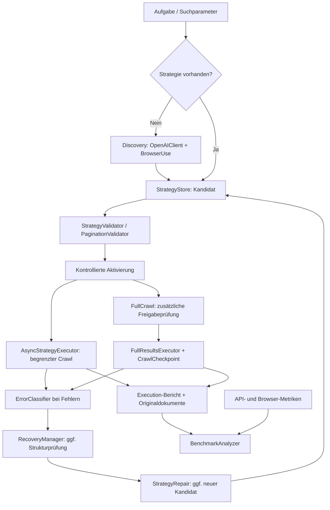
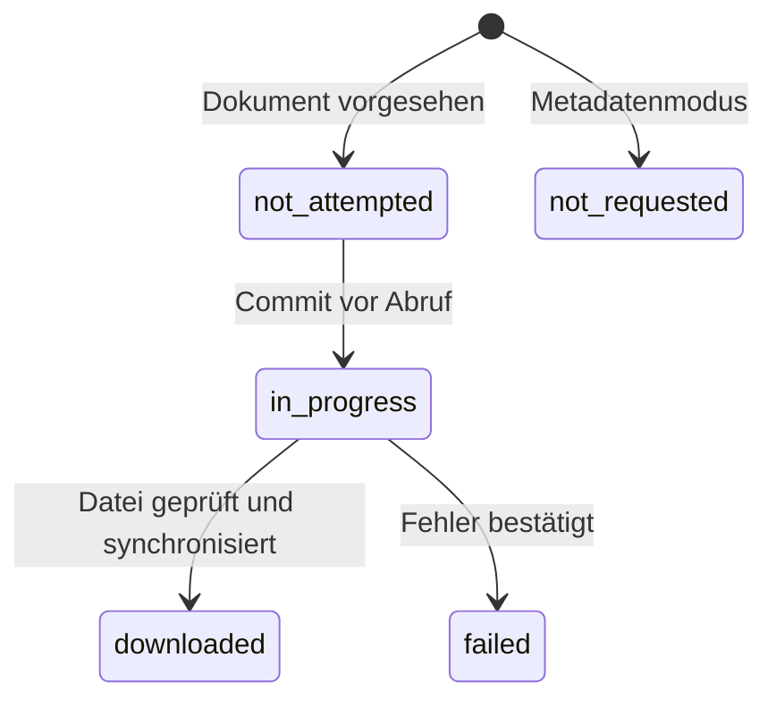
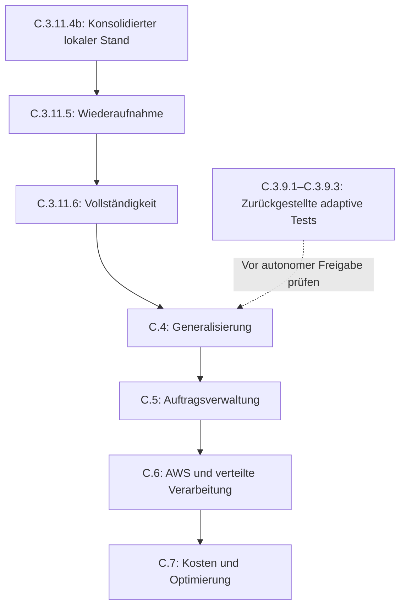

# KI-Crawler – Technische Projektdokumentation

**Stand:** C.3.11.4b · 27. November 2026  
**Geltungsbereich:** vollständiges `src/` aus `KI_Crawler_src_C3114b.zip`  
**Ablage:** `README.md` im Repository-Hauptverzeichnis

Diese Dokumentation ist ein Betriebs- und Entwicklerhandbuch. Sie beschreibt den implementierten Stand, die Verzeichnisse, die Verantwortlichkeiten sämtlicher Python-Dateien, die Aufrufmöglichkeiten, die erzeugten Daten und die Grenzen der aktuellen Ausführung. Geplante Funktionen sind ausdrücklich als solche gekennzeichnet.

## Installation – Schnellstart

Voraussetzungen: Debian/Linux beziehungsweise eine kompatible POSIX-Umgebung, Python 3.14 oder neuer (`requires-python = ">=3.14"`) und für den bevorzugten Installationsweg der Paketmanager `uv`. Die Projektdateien `README.md`, `pyproject.toml`, `uv.lock` und `requirements.txt` liegen gemeinsam im Repository-Hauptverzeichnis, neben dem Verzeichnis `src/`.

```text
KI-Crawler/
├── README.md
├── pyproject.toml
├── uv.lock
├── requirements.txt
├── .venv/              # wird bei der Installation erzeugt
└── src/
    ├── crawler/
    ├── tests/
    └── ...
```

### Variante A – Installation mit uv (bevorzugt)

Falls `uv` noch nicht installiert ist, siehe [offizielle uv-Installationsanleitung](https://docs.astral.sh/uv/getting-started/installation/). Alle folgenden Installationsbefehle zunächst im Repository-Hauptverzeichnis ausführen:

```bash
uv python install 3.14
uv sync --locked
uv run --locked python -m playwright install chromium
```

`pyproject.toml` und `uv.lock` werden gemeinsam im Git-Repository versioniert. `uv sync --locked` richtet die virtuelle Umgebung anhand der festgeschriebenen Paketversionen ein und bricht ab, falls die Lockdatei nicht zur Projektkonfiguration passt. Dadurch werden unbeabsichtigte Änderungen an der Lockdatei verhindert.

Falls Chromium unter Linux wegen fehlender Systembibliotheken nicht startet, die benötigten Bibliotheken zusätzlich installieren (gegebenenfalls mit Administratorrechten):

```bash
uv run --locked python -m playwright install --with-deps chromium
```

Anschließend zum vereinbarten Working Directory wechseln und die Installation lokal prüfen:

```bash
cd src
uv run python --version
uv run python tests/main_tests.py test_project_paths test_checkpoint test_test_runner
```

### Variante B – Installation ohne uv (venv und pip)

Falls Python 3.14 bereits als `python3.14` verfügbar ist, im Repository-Hauptverzeichnis ausführen:

```bash
python3.14 -m venv .venv
source .venv/bin/activate
python -m pip install -r requirements.txt
python -m playwright install chromium
```

Bei fehlenden Chromium-Systembibliotheken kann zusätzlich `python -m playwright install --with-deps chromium` erforderlich sein. Unter Debian muss die Unterstützung für `venv` für den verwendeten Python-Interpreter vorhanden sein.

```bash
cd src
python --version
python tests/main_tests.py test_project_paths test_checkpoint test_test_runner
```

Bei dieser Variante werden die weiteren im Handbuch aufgeführten Befehle `uv run python ...` durch `python ...` innerhalb der aktivierten virtuellen Umgebung ersetzt. Die beiden Installationswege sind Alternativen; sie müssen nicht nacheinander ausgeführt werden.

### Python-Abhängigkeiten

Die `requirements.txt` wurde direkt aus `[project].dependencies` der bereitgestellten `pyproject.toml` (Projekt `ki-crawler`, Version `0.1.0`) erstellt:

```text
defusedxml>=0.7.1
jsonschema>=4.26.0
openai>=3.60.0
playwright>=1.65.2
regex>=2026.11.25
requests>=2.34.2
```

Die oben gezeigte bisherige `requirements.txt` enthält Mindestversionen. Für reproduzierbare Installationen ist die im Repository versionierte `uv.lock` maßgeblich; sie enthält auch die aufgelösten transitiven Abhängigkeiten. Künftig wird `requirements.txt` direkt aus der Lockdatei generiert und gemeinsam mit dieser versioniert. Der bisherige Inhalt wird dadurch durch exakt aufgelöste Versionen ersetzt. Python-Standardbibliotheken (z. B. SQLite, asyncio und unittest) müssen nicht separat installiert werden. Der Chromium-Browser wird erst durch den zusätzlichen Playwright-Installationsbefehl eingerichtet.

### Abhängigkeiten aktualisieren und exportieren

Abhängigkeiten werden bevorzugt mit uv verwaltet. Nach einer bewussten Änderung der Abhängigkeiten im Repository-Hauptverzeichnis die Lockdatei aktualisieren und die alternative pip-Installationsdatei neu erzeugen:

```bash
uv lock
uv sync --locked
uv export --locked --format requirements.txt --no-emit-project -o requirements.txt
```

Für eine gezielte Aktualisierung einer bestehenden Abhängigkeit kann beispielsweise `uv lock --upgrade-package playwright` verwendet werden. Anschließend die Tests ausführen und `pyproject.toml`, `uv.lock` und `requirements.txt` gemeinsam committen, soweit sie geändert wurden. `.venv/` bleibt lokal und wird nicht versioniert.

### API-Konfiguration

Für KI-gestützte Discovery und gegebenenfalls KI-Reparaturen muss ein gültiger OpenAI-API-Schlüssel über die Umgebung bereitgestellt werden (`OPENAI_API_KEY`). Keine Schlüssel in die README, `requirements.txt`, `pyproject.toml` oder das Repository schreiben. Für die oben genannten lokalen Tests und die deterministische Verarbeitung ist keine kostenpflichtige API-Anfrage erforderlich.

Weitere Details zu Umgebung, Systemanforderungen und Funktionsprüfung stehen in [Kapitel 3](#3-umgebung-und-installation).

## Inhaltsverzeichnis

- [Installation – Schnellstart](#installation--schnellstart)

1. [Ziel und Architektur](#1-ziel-und-architektur)
2. [Verzeichnisstruktur](#2-verzeichnisstruktur)
3. [Umgebung und Installation](#3-umgebung-und-installation)
4. [Produktivcode – Module und Schnittstellen](#4-produktivcode--module-und-schnittstellen)
5. [CLI-Referenz und typische Arbeitsabläufe](#5-cli-referenz-und-typische-arbeitsabläufe)
6. [Strategien und Referenzen](#6-strategien-und-referenzen)
7. [Dokumentenspeicher](#7-dokumentenspeicher)
8. [Ergebnisverzeichnisse und Datenformate](#8-ergebnisverzeichnisse-und-datenformate)
9. [Checkpoints und Wiederaufnahme](#9-checkpoints-und-wiederaufnahme)
10. [Kosten und Benchmark](#10-kosten-und-benchmark)
11. [Testsystem](#11-testsystem)
12. [Fehlerbehandlung und Betrieb](#12-fehlerbehandlung-und-betrieb)
13. [Entwicklungskonventionen und Erweiterung](#13-entwicklungskonventionen-und-erweiterung)
14. [Aktueller Projektstatus und offene Punkte](#14-aktueller-projektstatus-und-offene-punkte)
15. [Weitere Entwicklungsroadmap](#15-weitere-entwicklungsroadmap)

## 1. Ziel und Architektur

Der KI-Crawler ist ein lokaler Python-Pilot zur Extraktion strukturierter Daten aus Webseiten und zur Beschaffung der zugehörigen Originaldokumente. Die Architektur soll später auf eine AWS-Infrastruktur übertragen werden können. Der aktuelle Anwendungsfall ist die öffentliche Registerinformationssuche des Unternehmensregisters (Hamburg, Amtsgericht Hamburg, HRB). Ziel ist, die KI gezielt für die Entdeckung und gegebenenfalls Reparatur einer Strategie einzusetzen und die regulären Crawls ohne weitere LLM-Anfragen auszuführen.

Die Aufgaben sind getrennt:

- **Discovery:** KI und lokaler Browser untersuchen eine Seite und erzeugen einen strukturierten Strategievorschlag.
- **StrategyStore:** Versionierung, Validierungsnachweise und kontrollierte Aktivierung der Strategie.
- **Validierung:** unabhängige Browserdurchläufe, erwartete Filter, Stichproben, Downloadkontrollen und Paginierung prüfen.
- **Execution:** deterministische Browsersteuerung auf Basis der gespeicherten Strategie; Extraktion und optionaler Dokumentendownload.
- **Recovery:** Fehler klassifizieren; nur bei bestätigter struktureller Änderung kommt eine begrenzte KI-Reparatur in Betracht.
- **Persistenz und Auswertung:** Originaldateien, JSON-Berichte, SQLite-Checkpoints, CSV-Metriken und aggregierte Benchmarks getrennt speichern.



Die Abbildung zeigt Verantwortlichkeiten, keine bereits implementierte autonome Endlosschleife. Der vollständige Live-Crawl ist derzeit gesperrt; die mehrseitige Wiederaufnahme aus SQLite ist noch nicht implementiert. Der ältere begrenzte ResumePlanner arbeitet auf einem anderen, einseitigen Ausführungsbericht.

## 2. Verzeichnisstruktur

Alle nachfolgenden Shell-Beispiele verwenden `src` als Working Directory, sofern nicht anders angegeben.

```text
src/
├── README_C3114b.md
├── README_SRC_C3114b.md
├── crawler/                         # 30 Python-Dateien: Produktivcode und CLIs
├── tests/                           # 18 Python-Dateien: Tests, Runner, Test-CLI
├── strategies/
│   └── unternehmensregister.de/
│       ├── example_strategy.json
│       └── register_information/
│           ├── .lock
│           ├── manifest.json
│           ├── versions/
│           │   └── v0001.json
│           └── validation/
│               └── v0001_<sha256>.json
├── references/
│   └── unternehmensregister.de/
│       └── register_information/
│           ├── validation_reference.json
│           └── pagination_reference.json
├── documents/
│   ├── <crawl_id>/                  # je Auftrag gespeicherte Originale
│   ├── hamburg_de/                  # historische Pilotdokumente
│   ├── validation/<validation_id>/<crawl_id>/
│   └── ...                          # ältere direkt abgelegte Originale
└── results/
    ├── executions/
    │   ├── <crawl_id>_execution.json
    │   └── legacy/                  # alte Pilot-JSONs, extraction.json
    ├── discovery/<crawl_id>_strategy.json
    ├── validation/
    │   ├── <validation_id>_validation.json
    │   └── <validation_id>_pagination_validation.json
    ├── recovery/
    │   ├── <id>_recovery.json
    │   └── <id>_resume_plan.json     # bei zukünftiger Erzeugung
    ├── checkpoints/
    │   ├── queue.csv                 # historische Download-Warteschlange
    │   └── <crawl_id>.sqlite3        # bei Full-Crawl-Ausführung
    ├── metrics/
    │   ├── usage.csv
    │   ├── browser_timing.csv
    │   ├── validation_timing.csv
    │   └── documents.csv
    └── benchmark/
        ├── benchmark.json
        └── benchmark_runs.csv
```

| Verzeichnis | Zweck | Eigentümer / Erzeuger | Datenart |
|---|---|---|---|
| `crawler/` | Anwendungslogik und Kommandozeileneinstiege | Entwickler | Quellcode |
| `tests/` | Prüfung der Anwendung | Entwickler, TestRunner | Quellcode und synthetische Fixtures |
| `strategies/` | Operative, versionierte Crawling-Wissensbasis | StrategyStore | Verbindlicher Zustand |
| `references/` | Erwartungswerte für unabhängige Prüfungen | Bediener | Eingabedaten |
| `documents/` | Originale beschaffter Dateien | Executors, Validatoren, älterer Downloader | Primärdaten |
| `results/` | Berichte, Metriken und Auftragszustände | jeweilige Komponenten | Betriebs- und Ergebnisdaten |

`results/` ist nicht ausschließlich ein entbehrliches Ausgabeverzeichnis: Checkpoints und Queue sind operative Zustände. Die StrategyStore-Zertifikate gehören nicht in `results/validation/`, da sie für die Freigabe maßgeblich sind.

### 2.1 Zentrale Pfade (`ProjectPaths.py`)

`ROOT_DIR = Path(__file__).resolve().parents[1]` bezeichnet `src`, nicht den Repository-Root. Alle zentralen Defaults sind absolute `Path`-Objekte. Der Import erzeugt keine Verzeichnisse; die schreibenden Komponenten legen diese bei Bedarf an. Explizite Pfadargumente bleiben möglich.

| Konstanten | Ziel relativ zu `src/` |
|---|---|
| `ROOT_DIR` | `.` |
| `STRATEGIES_DIR`, `REFERENCES_DIR` | `strategies/`, `references/` |
| `DOCUMENTS_DIR`, `VALIDATION_DOCUMENTS_DIR` | `documents/`, `documents/validation/` |
| `RESULTS_DIR`, `EXECUTIONS_DIR`, `LEGACY_EXECUTIONS_DIR` | `results/`, `results/executions/`, `results/executions/legacy/` |
| `DISCOVERY_DIR`, `VALIDATION_DIR`, `RECOVERY_DIR` | `results/discovery/`, `results/validation/`, `results/recovery/` |
| `CHECKPOINTS_DIR`, `METRICS_DIR`, `BENCHMARK_DIR` | `results/checkpoints/`, `results/metrics/`, `results/benchmark/` |
| `USAGE_FILE`, `USAGE_JSONL_FILE` | `results/metrics/usage.csv`, `results/metrics/usage.jsonl` |
| `BROWSER_TIMING_FILE`, `VALIDATION_TIMING_FILE` | `results/metrics/browser_timing.csv`, `results/metrics/validation_timing.csv` |
| `DOCUMENTS_METRICS_FILE`, `DOWNLOAD_QUEUE_FILE` | `results/metrics/documents.csv`, `results/checkpoints/queue.csv` |

Hilfsfunktionen: `report_directory(suffix, results)` routet Berichte; `report_files(results, suffix)` liest alte flache und neue kategorisierte Dateien, ohne gleiche Dateien doppelt auszuwerten; `metric_inputs(names, root)` findet Metriken in kanonischen oder historischen Pfaden und erkennt Konflikte; `checkpoint_file(crawl_id, directory)` erzeugt einen geprüften Dateinamen.

## 3. Umgebung und Installation

Der lokale Entwicklungsbetrieb verwendet Debian/Linux, `uv`, Python 3.14 und Playwright/Chromium. Die bereitgestellte `pyproject.toml` verlangt Python `>=3.14` und definiert sechs externe Python-Abhängigkeiten. Die Installation mit uv sowie alternativ mit venv und pip ist im [Schnellstart am Anfang dieses Handbuchs](#installation--schnellstart) beschrieben. Das ursprüngliche `src`-Archiv enthält weder die übergeordnete Projektkonfiguration noch einen virtuellen Interpreter.

Die im Repository versionierte `uv.lock` ist die verbindliche Grundlage für die aufgelösten Python-Paketversionen einschließlich transitiver Abhängigkeiten. Die bisherige `requirements.txt` enthält Mindestversionen aus `pyproject.toml`; künftig wird sie gemäß Schnellstart aus `uv.lock` exportiert. Auf Linux können zusätzlich Chromium-Systembibliotheken erforderlich sein. SQLite, asyncio, unittest, pathlib und hashlib gehören zur Standardbibliothek. Die Dateisperren (`fcntl`) und Verzeichnissynchronisierung (`os.O_DIRECTORY`) setzen eine passende POSIX-Umgebung voraus.

Für echte KI-Aufrufe benötigt der OpenAI-SDK die API-Konfiguration, typischerweise `OPENAI_API_KEY` in der Umgebung. Schlüssel nicht in Quellcode, Reports oder ZIP-Archive übernehmen. Reguläre deterministische Ausführungen, Offline-Analysen und die vorgesehenen lokalen Tests benötigen keine kostenpflichtigen API-Aufrufe. API-Kosten sind separat vom ChatGPT-Abonnement zu betrachten.

Prüfe zunächst ohne Live-Crawl:

```bash
uv run python crawler/main_strategy.py status
uv run python crawler/main_execute_async.py --help
uv run python tests/main_tests.py test_project_paths test_checkpoint test_test_runner
```

## 4. Produktivcode – Module und Schnittstellen

### 4.1 KI-Anbindung und Strategieentdeckung

| Datei | Verantwortung | Zentrale Schnittstellen / Ausführung |
|---|---|---|
| `OpenAIClient.py` | Wrapper für Responses API, Web Search, Structured Outputs und Browser-Loop; Nutzungs- und Kostenlogging | `OpenAIClient(log_path=...)`, `create(model, prompt, ...)`; Bibliothek, keine eigene CLI |
| `BrowserUse.py` | Lokale Browserwerkzeuge für den KI-Agenten; DOM lesen und untersuchen, Browseraktionen, Funktionsaufruf-Loop und Timing | `BrowserUse`, `browser_loop`, `run_browser`, `allowed_url`, `measure`, `write_timings` |
| `StrategySchema.py` | JSON-Schema und erlaubte Locator-, Navigations-, Feld-, Dokument- und Paginierungsstrukturen | `DISCOVERY_SCHEMA`, `STRATEGY_SCHEMA`; v2 lesbar, neue Discovery v3 |
| `main_discovery.py` | KI-gestützte Discovery oder lokaler Import einer Strategie; Speichern eines Kandidaten | CLI, siehe Abschnitt 5 |

Discovery verwendet ein konkretes Ziel und eine Domain-Allowlist. Die KI soll keine fehlenden Daten erfinden. In Discovery werden wiederverwendbare Selektoren und Parameter statt eines einmaligen Extraktionsergebnisses erzeugt. Die aktuelle Implementierung setzt für Live-Discovery `gpt-6-luna`, maximal 35 Browser-Schritte und sichtbaren Browser. Der ursprüngliche Browser-Agent ist nicht mit dem deterministischen Executor gleichzusetzen.

### 4.2 Strategieausführung und Auftragssteuerung

| Datei | Verantwortung | Zentrale Schnittstellen / Ausführung |
|---|---|---|
| `StrategyExecutor.py` | Synchrone sequenzielle Ausführung; Schema, Navigation, Datenextraktion, Downloads, Paginierungsprüfung | `StrategyExecutor(...).run(...)`, `locator(...)`, `ExecutionError` |
| `AsyncStrategyExecutor.py` | Asynchroner Executor auf Basis der synchronen Struktur; Worker-Pool, getrennte Tabs bei Parallelbetrieb, Download-Pacing, Netzwerk- und Fehlerdiagnostik | `AsyncStrategyExecutor(...).run(...)` |
| `ExecutionPolicy.py` | Lokale Providergrenzen, Verifikations- und Reparaturbudgets, Vollcrawl-Freigabe | `get_policy(domain)`, `has_policy(domain)`, `ExecutionPolicy.check_workers(...)` |
| `FullCrawl.py` | Offline-Freigabeplan, vollständige Verarbeitung ganzer Ergebnisseiten, Ergebnismengenbegrenzung, Checkpoint-Anbindung | `full_crawl_plan(...)`, `FullResultsExecutor.run_full(...)` |
| `CrawlCheckpoint.py` | Persistenter, transaktionaler Fortschritt je Vollcrawl | `save_page`, `start_document`, `finish_document`, `finish_page`, `finish`, `inspect` |
| `main_execute.py` | Ältere synchrone CLI für begrenzte Ausführung | CLI; nicht der bevorzugte produktive Einstieg |
| `main_execute_async.py` | Aktueller Einstieg für Pilot-Crawl, optionales Recovery, Vollcrawl-Preflight und vollständigen Modus | CLI; bevorzugter Einstieg |
| `main_checkpoint.py` | Read-only-Abfrage eines SQLite-Checkpoints | CLI, keine Browser-/API-Anfragen |

Die synchrone CLI ist historisch und verwendet `load_active()` statt der strengeren `certified_active()`- und Scope-Prüfung der asynchronen CLI. Sie sollte nicht als Ersatz für deren Freigabeverfahren verwendet werden.

Der reguläre Executor validiert vor dem Browserstart die Strategieparameter und Felddefinitionen. Er prüft die Identität eines Datensatzes vor Downloads. PDF/XML werden auf zulässige Struktur/Format und Größe geprüft (Standard-Dateigrößenlimit 20 MiB); Prüfsummen werden gespeichert. Fehlende optionale Informationen bleiben `null`. Fehlende Pflichtfelder und mehrdeutige Schlüssel führen zum Abbruch. Die Browsersteuerung beschränkt sich auf erlaubte HTTPS-Domains, berücksichtigt Zugangsbeschränkungen und akzeptiert bei dem bekannten Cookie-Dialog nur technisch notwendige Cookies.

Asynchron bedeutet nicht automatisch parallele Abrufe. Für das Unternehmensregister erlaubt die Policy maximal einen Worker. Die generische Pool-Implementierung ist auch für mehrere Worker ausgelegt, aber nur mit passender Provider-Policy und bestätigter Erlaubnis. Der asynchrone Executor enthält einen Mindestabstand von 0,25 Sekunden nach einem abgeschlossenen Download pro Worker (`MIN_DOCUMENT_INTERVAL_SECONDS`). Das schützt vor sehr schnellen Download-Bursts; es ersetzt keine Providerlimits. Standard-Interaktionstimeout: 10 s; asynchrones Download-Timeout: 30 s. Der Mindestabstand bleibt beim Seitenwechsel erhalten und wird als `download_pacing` gemessen.

### 4.3 Validierung und Versionierung

| Datei | Verantwortung | Zentrale Schnittstellen |
|---|---|---|
| `StrategyStore.py` | Versionierte lokale JSON-Strategien, Manifest, Locks, Prüfsummen, Zertifikate und Aktivierungsrevision | `save`, `load`, `load_active`, `validation_snapshot`, `begin_validation`, `certify`, `certified_active`, `promote_certified` |
| `StrategyValidator.py` | Fachliche Validierung gegen unabhängig geprüfte Referenz; getrennte Browser-Sitzungen, optionaler Dokumentennachweis | `StrategyValidator.validate`, `check_reference`, `compare_records`, `verify_file` |
| `PaginationValidator.py` | Technische und referenzbasierte Mehrseitenprüfung in zwei Sitzungen, Seiten-Hashes, Steuerelemente, Endnachweis | `validate_technical`, `validate`, `check_reference` |
| `main_strategy.py` | Status, Validierung, Aktivierung, Rollback, einseitige Wiederaufnahme | CLI-Unterbefehle in Abschnitt 5 |

Eine formal gültige Strategie ist noch keine fachlich validierte Strategie. Ein technisch erfolgreicher Seitenwechsel ist ebenfalls noch keine Bestätigung des vollständigen Datenbestandes. Der StrategyStore bindet Zertifikate an Strategie-Hash und Aktivierungszustand. Eine technische Paginierungsvalidierung erzeugt keinen Aktivierungsnachweis.

### 4.4 Fehleranalyse und Recovery

| Datei | Verantwortung | Zentrale Schnittstellen |
|---|---|---|
| `ErrorClassifier.py` | Klassifikation von Ausführungs- und Workerfehlern ohne KI | `ErrorClassifier.classify(report)`, `attach_error_classification`; auch Offline-CLI |
| `RecoveryManager.py` | Entscheidet anhand von Fehlerklasse und Policy, ob strukturelle Prüfung/Reparatur überhaupt möglich ist | `recover(report, authorized=False, repair_enabled=False)` |
| `StructureVerifier.py` | Begrenzte read-only-Strukturprüfung in Browser-Sitzung; beobachtete alternative Zeilen-/Container-Locators prüfen | `verify(...)`, `repair_target`, `replace_locator` |
| `StrategyRepair.py` | Beschränkte LLM-Auswahl einer verifizierten Locator-Alternative; kein freies Umschreiben der Strategie | `propose(strategy, verification, crawl_id)` |
| `ResumePlanner.py` | Konservative Wiederaufnahme bereits bekannter Datensätze aus einem einseitigen Execution-Bericht | `build(report)`, `execute(...)` |
| `main_recovery.py` | Offline-Fehleranalyse, optional Strukturprüfung und begrenzte Reparatur | CLI |

Der RecoveryManager darf nicht bei jedem technischen Fehler ein LLM befragen. Er fordert bestätigte strukturelle Evidenz, begrenzt Reparaturversuche und speichert einen neuen Kandidaten statt die bisherige Strategie direkt zu überschreiben. Für tatsächliche Reparaturaufrufe gelten aktuell maximal ein LLM-Aufruf je Quellversion, ein Output-Budget von 600 Tokens und begrenzte DOM-Proben. Der persistente Reparaturmarker liegt beim jeweiligen StrategyStore, nicht im allgemeinen Recovery-Reportordner.

### 4.5 Auswertung, Pfade und ältere Pilot-Komponenten

| Datei | Verantwortung | Zentrale Schnittstellen / Ausführung |
|---|---|---|
| `BenchmarkAnalyzer.py` | Historische Reports und Metriken über IDs verbinden, Zeiten und Kosten aggregieren, Vollständigkeit der Kostendaten prüfen | `analyze`, `write_report`, `aggregate_usage`, `timing_summary` |
| `ProjectPaths.py` | Zentrale lokale Pfade und kompatible Datei-Suche | siehe Abschnitt 2.1 |
| `main_benchmark.py` | Offline-Benchmark erzeugen | CLI |
| `main_migrate_results.py` | Dry-Run und kontrollierte Migration alter Pfade | CLI, `migration_plan`, `check_plan`, `apply_plan` |
| `DocumentDownloader.py` | Älterer direkter HTTP-Downloader mit CSV-Warteschlange, Dateiprüfung und Logging | `enqueue`, `process_queue`, `import_failed` |
| `crawler.py` | Früherer Web-Search-Pilot für strukturierte Daten und Download-URLs; startet API-Aufruf auf Modulebene | Historisches Skript; nicht importieren oder versehentlich starten |
| `main_browser.py` | Früherer KI-gesteuerter Browser-Crawl (ein Unternehmen, CD/SI, bis 20 Schritte) | Historisches Skript; verursacht Live- und API-Aufrufe |
| `retry_downloads.py` | Import früherer fehlgeschlagener Downloads und Verarbeitung der alten Queue | Historisches Skript; keine moderne SQLite-Wiederaufnahme |

Die alten Pilotkomponenten werden zur Reproduzierbarkeit erhalten. Insbesondere erwartet der alte `DocumentDownloader` beim Abruf `file_type`, obwohl es in seinen Queue-Feldern nicht enthalten ist. Diese Inkonsistenz ist offen. Neue Crawls sollten den deterministischen Browser-Executor verwenden. Die alten Skripte haben keine gleichwertige Full-Crawl-Freigabeprüfung.

## 5. CLI-Referenz und typische Arbeitsabläufe

Alle Befehle aus `src/`. Namen in spitzen Klammern sind Platzhalter; vor Ausführung durch echte Werte ersetzen. Live-Aufrufe nur bei tatsächlich erlaubtem Umfang ausführen. CLI-Bestätigungen sind Bedienerangaben und keine vom Provider erteilte Erlaubnis.

### 5.1 Status und Discovery

```bash
uv run python crawler/main_strategy.py status
```

Liest das Manifest und zeigt Versionsstatus, aktive Version und Validierungsbezug. Im gelieferten Stand: Version 1, Schema 2, `validated`, `active_version: null`.

Neue Discovery (Browser + kostenpflichtige API):

```bash
uv run python crawler/main_discovery.py
```

Offline-Import eines bereits erzeugten Discovery-JSONs (nur falls tatsächlich eine neue Version angelegt werden soll):

```bash
uv run python crawler/main_discovery.py --import-strategy \
    results/discovery/0dda6bfd-e4a2-4e16-a5a4-bc045b519e02_strategy.json
```

`--crawl-id` kann beim Import explizit angegeben werden; sonst wird die ID ggf. aus dem Namen `*_strategy.json` abgeleitet. Der Import verändert den StrategyStore und aktiviert keine Strategie. Der Discovery-Bericht ist im gelieferten Stand bereits als Version 1 gespeichert; ein erneuter Import ist für den normalen Betrieb unnötig.

### 5.2 Strategie validieren und aktivieren

Referenz zunächst unabhängig prüfen. Beispiel für begrenzte Validierung einschließlich Dokumentenstichprobe, nur nach bestätigter Abrufberechtigung:

```bash
uv run python crawler/main_strategy.py validate 1 \
    --reference references/unternehmensregister.de/register_information/validation_reference.json \
    --verify-authorized --download-authorized
```

Optionen: `--verify-authorized` bestätigt erlaubte Prüf-Suchen, `--download-authorized` die Dokumentenstichprobe, `--headless` startet ohne sichtbares Fenster, `--activate` aktiviert nach vollständig bestandener Prüfung. Ohne ausreichende Nachweise bleibt die Validierung partiell bzw. schlägt fehl. Der normale Validierungsbericht landet unter `results/validation/`; die verbindliche Zertifizierung liegt im StrategyStore.

Die gelieferte Version 1 besitzt bereits einen bestandenen begrenzten Validierungsbericht und ein Zertifikat. Eine Wiederholung der Live-Validierung ist nicht allein wegen der Verzeichnisumstellung erforderlich. Nach Überprüfung von Zertifikat, Referenz und beabsichtigtem Abrufumfang kann der Bediener aktivieren:

```bash
uv run python crawler/main_strategy.py activate 1 --expected-active none
```

Dieser Befehl verändert das Manifest. `--expected-active` muss dem tatsächlichen Zustand entsprechen (Zahl oder `none`). Er schützt vor dem Überschreiben zwischenzeitlich geänderter Freigaben. Aktivierung ist keine Freigabe für vollständige Datenabzüge.

Rollback-Beispiel für eine spätere Situation mit aktiver Version 2 und gültig neu validierter Version 1:

```bash
uv run python crawler/main_strategy.py rollback 1 --expected-active 2 \
    --reason 'Regression der neuen Strategie'
```

Im gelieferten Zustand ist dieses Beispiel noch nicht anwendbar. Rollback setzt die entsprechenden aktuellen Zertifikate voraus.

### 5.3 Begrenzte deterministische Ausführung

Nach Aktivierung der passenden Strategie, soweit der Umfang erlaubt ist:

```bash
# Ein Unternehmen, eine Seite, nur Metadaten
uv run python crawler/main_execute_async.py

# Ein Unternehmen, CD und SI herunterladen
uv run python crawler/main_execute_async.py --download

# Begrenzter Mehr-Unternehmens-Test innerhalb der zertifizierten Referenz
uv run python crawler/main_execute_async.py --download --max-companies 3 \
    --multi-company-authorized
```

| Parameter | Funktion und Default |
|---|---|
| `--candidate-version N` | Expliziter Test eines Kandidaten (`candidate`-Status); maximal 3 Unternehmen, 1 Seite. Für die bereits `validated`-Version 1 nicht passend. |
| `--max-companies`, `--max-pages` | Pilot-Defaults jeweils 1. Aktiver Pilot bleibt auf eine Seite und die Größe der zertifizierten Stichprobe begrenzt. |
| `--download` | Ohne Flag nur Metadaten; mit Flag tatsächliche Dokumentenanforderungen. |
| `--workers` | Default 1; beim Unternehmensregister ausschließlich 1. |
| `--parallel-authorized` | Bestätigung erlaubter Parallelität; überschreibt die Provider-Policy nicht. |
| `--multi-company-authorized` | Für Dokumentenabruf mehrerer Unternehmen erforderlich. |
| `--headless` | Browser ohne sichtbares Fenster (Default: sichtbar). |
| `--federal-state` | Default `Hamburg`. |
| `--register-court-ui` | Default `Hamburg`, Auswahltext der Suchmaske. |
| `--register-court` | Default `Amtsgericht Hamburg`, erwarteter fachlicher Gerichtsname. |
| `--register-type` | Default `HRB`. |
| `--recover` / `--repair` | Optionale Strukturprüfung bzw. begrenzte KI-Reparatur; `--repair` setzt `--recover` voraus. |

Die Suche ist aktuell auf die Domain und Strategie in den CLI-Konstanten ausgerichtet. Geänderte Suchparameter sind nicht automatisch zertifiziert. Der niedrigere Executor besitzt eigene Sicherheitsgrenzen; eine manuell konstruierte Python-Instanz ersetzt nicht die CLI-Freigaben.

Ergebnis: `results/executions/<crawl_id>_execution.json`, bei Downloads Dateien unter `documents/<crawl_id>/`, Browseraktionen in `results/metrics/browser_timing.csv`. `registered_office` und `source_url` werden bei CLI-Ausgabe ggf. mit `null` ergänzt. `status=completed` kann auch ein erfolgreich erreichter Pilot-Grenzwert sein.

### 5.4 Technische und fachliche Paginierungsvalidierung

Technischer Live-Test ohne Referenz und ohne Dokumentenabruf:

```bash
uv run python crawler/main_strategy.py validate-pagination 1 \
    --technical-only --pages 2 --verify-authorized
```

`--pages` akzeptiert 2 oder 3 (Default 2). Suchfilter können in diesem Modus über dieselben vier Parameter wie beim Executor überschrieben werden. Der Validator prüft in zwei Sitzungen alle Zeilen, die Schlüssel, Filter, Download-Steuerelemente und stabilen Seiten-Hashes. Er fordert keine Dateien an. Technischer Erfolg liefert Exitcode 0, obwohl der Gesamtbericht `partial` lautet. Der Bericht ist kein Strategie-Zertifikat.

Referenzbasierter Modus, **erst nach Vervollständigung der vorhandenen Paginierungsreferenz**:

```bash
uv run python crawler/main_strategy.py validate-pagination 1 \
    --reference references/unternehmensregister.de/register_information/pagination_reference.json \
    --verify-authorized --download-authorized
```

In diesem Modus stammen Filter und Seitenanzahl aus der Referenz, `--pages` und Filter-Overrides sind nicht zulässig. Der Download-Test ist auf die Stichprobe der letzten geprüften Seite beschränkt. Für die aktuelle große Suchmenge ist die Prüfung des tatsächlichen Endes nicht durch die 2–3-Seiten-Stichprobe abgedeckt. Es gibt noch keinen allgemeinen Endseiten-Validator für 34 Seiten.

### 5.5 Vollständiger Crawl – derzeit ausschließlich Preflight

Der Offline-Plan prüft Strategie, Report, Parameter, Nachweise und Freigaben, startet weder einen Browser noch eine API-Anfrage:

```bash
uv run python crawler/main_execute_async.py --all-results --plan-only --download \
    --pagination-validation results/validation/ed551293-0bfd-4583-9238-35876704b810_pagination_validation.json
```

Erwartet im gelieferten Stand: `ready: false`, Liste der `blockers`, Exitcode 2. Auch ohne `--download` ist der Vollcrawl gesperrt. Der Plan wird als JSON auf stdout ausgegeben; er wird nicht automatisch als Bericht gespeichert. Bei Bedarf die Ausgabe per Shell-Umleitung in eine selbst gewählte Datei speichern.

Vollmodus-Optionen: `--pagination-validation` (Pflicht), `--plan-only`, `--download`, `--checkpoint-root` (Override), `--full-crawl-authorized` und bei Download mehrerer Unternehmen `--multi-company-authorized`. `--all-results` ist nicht mit Kandidatentests, Pilot-Mengenlimits, mehreren Workern oder Recovery kombinierbar.

Für eine zukünftige Freigabe müssen gleichzeitig erfüllt sein: aktivierte zertifizierte Strategie, passender Hash, Start-URL, Parameter, Aktivierungsrevision, explizite Schema-v3-Endregel, reproduzierte Paginierung, fachliche Referenz, geprüfter Endzustand, bei Downloads bestätigte spätere Dokumentenstichprobe, tatsächlich bestätigte Provider-Erlaubnis und aktivierte Provider-Policy. Die aktuelle Policy bleibt `full_crawl_enabled=False`. Die CLI-Flags allein ändern daran nichts.

Bei freigegebenem Vollmodus arbeitet der Executor jeweils ganze Seiten ab und protokolliert sie persistent. Die Sicherheitsgrenzen sind 100 Seiten, 3.000 Unternehmen, 6.000 Dokumente. Sie sind technische Notbremsen, keine Berechtigung zur Abrufmenge. Eine Seite wird nicht wegen der Mengenlimits mitten in der Extraktion abgeschnitten. Erreicht der Auftrag ein Limit ohne Endnachweis, bleibt die Abdeckung unvollständig. Es gibt keine automatische Suchaufteilung zur Umgehung der 1.000-Treffer-Grenze.

### 5.6 Checkpoints und Fehleranalyse

```bash
# Checkpoint auslesen; nur wenn die betreffende Datei existiert
uv run python crawler/main_checkpoint.py results/checkpoints/<crawl_id>.sqlite3

# Vorhandenen Fehlerbericht rein offline klassifizieren
uv run python crawler/ErrorClassifier.py \
    results/executions/69fd1f44-80de-4797-8068-cb6f0fde32db_execution.json

# Offline-Recovery-Entscheidung protokollieren
uv run python crawler/main_recovery.py \
    results/executions/69fd1f44-80de-4797-8068-cb6f0fde32db_execution.json
```

Der Classifier verändert die Datei nicht. `main_recovery.py` schreibt einen neuen Recovery-Bericht. `--verify` erlaubt nur eine tatsächlich freigegebene begrenzte Strukturprüfung, `--repair` zusätzlich eine KI-Reparatur nach bestätigtem Strukturproblem; `--repair` ohne `--verify` ist unzulässig. `--headless` ist optional. Die historische HTTP-500-Ausführung im Beispiel ist kein Reparaturfall.

Einseitiger Wiederaufnahmeplan (offline, nur für einen qualifizierenden strukturellen Fehler):

```bash
uv run python crawler/main_strategy.py resume-plan results/executions/<crawl_id>_execution.json
```

Nur wenn der Plan `ready` ergibt und die erforderlichen Rechte und aktuellen Nachweise vorliegen, kann der begrenzte ResumePlanner über `main_strategy.py resume <execution-report> --resume-authorized` ausgeführt werden. Bei mehreren Unternehmen ist ggf. `--multi-company-authorized` nötig. Er erwartet den ursprünglichen Execution-Bericht, nicht die SQLite-Datei oder den erzeugten Resume-Plan. Er ist nicht für einen beliebigen fehlgeschlagenen Auftrag geeignet (siehe Abschnitt 9).

### 5.7 Benchmark und Migration

```bash
uv run python crawler/main_benchmark.py \
    --baseline-id 40bbf6d2-d1b9-42f7-b475-cd3d0ece27d4 --baseline-companies 1
```

Optionen: `--results`, wiederholbares `--timing`, wiederholbares `--usage`, `--output`, `--baseline-id`, `--baseline-companies`. Default: zentrale Verzeichnisse und automatische Suche bekannter Metriken. Die Baseline-Anzahl ist eine explizite fachliche Angabe; ohne ID keine Anzahl übergeben.

```bash
# Migration nur simulieren
uv run python crawler/main_migrate_results.py
```

Das konsolidierte Archiv ist bereits migriert. `--apply` ist nur für noch vorhandene alte Dateien vorgesehen; zuvor laufende Prozesse beenden, Sicherung anlegen und Dry-Run prüfen. `--register-references` verschiebt explizit passende ältere Referenzen zur Unternehmensregister-Strategie. `--root` erlaubt eine andere Test-/Projektbasis. Keine bestehende Zieldatei überschreiben, keine CSV-Zusammenführung, keine inhaltliche Änderung. Unbekannte Dateien und bestehende SQLite-Zustände bleiben unverändert. Die Migration ist nicht als Gesamtheit atomar.

### 5.8 Historische Einstiege (nur zu Reproduktionszwecken)

`crawler/main_execute.py` akzeptiert `--candidate-version`, `--download`, `--headless`, `--max-companies`, `--max-pages` und die vier Suchfilter. Bevorzuge die asynchrone CLI, die zusätzlich den zertifizierten Scope und Provider-Policy prüft.

`crawler/crawler.py` startet direkt den Web-Search-Piloten, `crawler/main_browser.py` den früheren KI-Browser-Piloten und `crawler/retry_downloads.py` die alte HTTP-Queue-Verarbeitung. Alle können bei Ausführung tatsächliche Anfragen auslösen, die ersten beiden auch API-Kosten. Sie sind kein regulärer Bestandteil des aktuellen Betriebsablaufs. Keine automatische Ausführung dieser Dateien beim Testimport.

## 6. Strategien und Referenzen

### 6.1 StrategyStore (`strategies/`)

`strategies/<domain>/<strategy_name>/` enthält die operative Wissensbasis. `example_strategy.json` außerhalb des Store-Unterverzeichnisses ist ein Beispiel, keine aktive Strategie. `versions/v0001.json` enthält die rohe Strategie (kein `metadata`-Wrapper auf Dateiebene). `manifest.json` enthält die zugehörigen Versionsmetadaten, Status, Hashbezüge, die aktive Version und ggf. Aktivierungsrevision. `StrategyStore.load()` liefert Strategie und Metadaten zusammen. `validation/vNNNN_<sha256>.json` enthält einen gebundenen Validierungsnachweis. `.lock` und später erzeugte Recovery-/Resume-Marker dienen der kontrollierten Zustandsänderung. Nicht manuell löschen oder den aktiven Zustand per JSON-Editor umschreiben.

Lebenszyklus: `candidate` → `validated` → `active`; weitere Status und Übergänge werden über den Store verwaltet. Die Strategie-JSON selbst enthält den Discovery-Status `candidate`; der Manifest-Status `validated` ist kein Widerspruch. Die CLI aktiviert über `promote_certified` und prüft den aktuellen Hash und erwarteten aktiven Zustand. Ein reparierter Vorschlag wird als neue Version gespeichert. Alte Versionen bleiben erhalten; fehlgeschlagene Nachvalidierung kann eine frühere Freigabe entziehen.

### 6.2 Inhalt der aktuell gespeicherten Strategie

Die vorhandene Version 1 verwendet Schema 2. Ihre Parameter sind `federal_state`, `register_court_ui`, `register_type`. `navigation` beschreibt die Suchmaske als Folge von Aktionen mit Locator- und Wartebedingungen. `records` beschreibt Ergebniscontainer, Zeilen, Schlüssel, Felder, optionale Leerzustände und Dokumentenregeln. `pagination` beschreibt den Vorwärtslink und die Wartebedingung.

| Feld | Bedeutung im aktuellen Vertrag |
|---|---|
| `company_name` | Pflichtfeld, Teil des Schlüssels |
| `register_court` | Pflichtfeld, Teil des Schlüssels |
| `register_type` | Pflichtfeld, Teil des Schlüssels |
| `register_number` | Pflichtfeld, Teil des Schlüssels |
| `federal_state` | Formal optional, im aktuellen Ausführungsscope als erwarteter Filter geprüft |
| `source_url` | Optional; kann sitzungsabhängige Suchparameter enthalten |
| `registered_office` | Nicht in der gespeicherten Extraktionsstrategie enthalten, CLI ergänzt ggf. `null` |
| `documents` | Zwei Regeln: CD/PDF und SI/XML, `browser_download` |

Der Schlüssel besteht in Version 1 aus `company_name`, `register_court`, `register_type`, `register_number` in dieser Reihenfolge. Nicht allein nach Firmenname deduplizieren. Die aktuelle Zeilenregel verwendet `tr[data-testid="companyDataRow"]`. Registerinformationen werden teilweise aus einer geprüften vorhergehenden Tabellenzeile extrahiert. CSS-Selektoren und ARIA-Rollen können sich bei Änderungen der Webseite ändern; nicht als allgemein gültige Register-API behandeln.

Schema 3 erweitert den Paginierungsvertrag um `end`. Zulässig sind eine explizite Regel für ein deaktiviertes Vorwärtselement (`next_disabled`) oder einen sichtbaren Endmarker (`visible_marker`), bzw. `null` für unbekannt. Ein fehlender oder versteckter Link allein ist kein Endnachweis. Die Executor-Logik prüft stabile, unterschiedliche Seiten-Signaturen sowie seitenübergreifend eindeutige Schlüssel. Gleichwertige sichtbare Vorwärtslinks werden nur nach Prüfung gleicher Ziel-URL und Zustände zusammengefasst; widersprüchliche Links führen zum Abbruch. Bestehende Schema-2-Dateien werden nicht nachträglich umgeschrieben.

### 6.3 Manuelle Referenzen (`references/`)

Referenzen sind Eingabedaten, keine automatisch erzeugten Validierungsberichte. Sie werden unabhängig anhand der Originalseite bzw. erlaubter Originaldokumente gepflegt. Die Anwendung prüft die Form und den expliziten Bestätigungswert `manually_verified`, kann die tatsächliche menschliche Prüfung aber nicht selbst nachweisen.

`validation_reference.json` (Version 1) enthält Quelle, Suchparameter, erwartete Filter, drei repräsentative Registerdatensätze und erwartete Dokumentdateinamen-Präfixe. Sie ist die Grundlage für die begrenzte fachliche Validierung. `pagination_reference.json` (Version 2) enthält zusätzlich 2–3 aufeinanderfolgende Seiten ab Seite 1 mit tatsächlicher Zeilenanzahl, den ersten 2–3 Datensätzen (bei einer Zeile nur einen), `expect_end` und Präfixen für die letzte geprüfte Seite.

**Wichtiger Befund im gelieferten Archiv:** Beide Referenzen haben `manually_verified: true`. Die Paginierungsreferenz enthält jedoch auf Seite 2 noch `row_count: null`, Platzhalterdatensätze und `null`-Präfixe; der Quelltext verweist ebenfalls auf eine noch nicht beobachtete Seite 2. Diese Datei ist nicht als vollständige Referenz verwendbar. Vor Nutzung die Werte unabhängig prüfen und vervollständigen; der technische Modus benötigt sie nicht. Eine Kopie automatisch aus dem zu prüfenden Crawl zu generieren, wäre keine unabhängige Referenz. Auch die erste Referenz sollte bei erneuter Zertifizierung auf Aktualität kontrolliert werden.

## 7. Dokumentenspeicher

`documents/` enthält die tatsächlich beschafften Originaldateien, nicht lediglich deren Metadaten. CD steht in diesem Pilot für den chronologischen Abdruck (PDF), SI für strukturierten Registerinhalt (XML). Der Executor unterstützt aktuell PDF und XML, keine allgemeine Verarbeitung beliebiger Dateitypen. Bei Downloads werden Dateiname, Pfad, Typ, Größe und SHA-256 im Bericht erfasst. Ein Download über ein Browser-Ereignis muss keine dauerhaft nutzbare `document_url` liefern; `null` ist dort zulässig.

- Neue reguläre Aufträge: `documents/<crawl_id>/`.
- Dokumentenstichproben: `documents/validation/<validation_id>/<crawl_id>/`.
- Alte Pilotdaten: direkte Dateien in `documents/` und Unterordner wie `hamburg_de/`; bei Migration beibehalten.

Dateien nicht unabhängig vom zugehörigen Bericht/Checkpoint umbenennen, verschieben oder inhaltlich verändern. Historische Berichte können relative oder absolute Pfade enthalten. Eine Verzeichnisumstellung darf nicht blind in historischen JSONs umgeschrieben werden; bei Verlagerung auf einen anderen Host ist die Pfadauflösung gesondert zu prüfen. Der Hash sichert die Zuordnung des exakten Dateiinhalts, nicht automatisch die vollständige fachliche Richtigkeit des Registerdokuments.

## 8. Ergebnisverzeichnisse und Datenformate

### 8.1 `results/executions/` und `legacy/`

Moderne `*_execution.json`-Berichte sind das Ergebnis eines deterministischen Auftrags. Wichtige Felder (je nach Berichtsversion):

| Bereich | Felder / Interpretation |
|---|---|
| Identität | `crawl_id`, `strategy_version`, `schema_version`, ggf. `strategy_sha256`, `activation_revision`, `domain`, `strategy_name` |
| Suchauftrag | `parameters`, `expected_fields`, `downloads_enabled`, ggf. `start_url` |
| Ergebnis | `companies` mit extrahierten Feldern und `documents` |
| Abschluss | `status`, `stop_reason`, `pagination_end_verified`, `pagination_end_evidence` |
| Diagnose | `error`, `failure_stage`, `error_snapshot`, `access_restriction`, `navigation_checks`, `worker_failures`, `notes`, `error_classification` |
| Messwerte | `metrics`: Dauer, LLM-Aufrufe, Seiten, extrahierte Unternehmen, Downloadversuche, erfolgreiche Downloads, Workerstatistik |
| Vollmodus | `mode`, `page_results`, `checkpoint_path`, `displayed_results_traversed`, `result_limit_detected`, `completeness_verified`, `coverage_status` |

Die historische Ablage `legacy/` enthält freie JSON-Ausgaben aus der frühen Web-Search-/Browser-Agent-Phase und `extraction.json`. Diese sind keine modernen Execution-Berichte. Der Benchmark interpretiert sie nicht als solche; die Baseline kann über die zugehörige ID und Timing-Daten rekonstruiert werden.

Beispiel eines einzelnen Dokumenteintrags (illustrativ):

```json
{
    "document_type": "CD",
    "file_type": "pdf",
    "document_url": null,
    "filename": null,
    "file_path": null,
    "download_status": "not_attempted",
    "size_bytes": null,
    "sha256": null
}
```

Die Bedeutung der Abschlussgründe ist wichtiger als `completed` allein: `company_limit` bzw. `page_limit` sind gewollte Pilotgrenzen, `safety_*_limit` sind Vollmodus-Sicherheitsgrenzen, `end_of_results` bezeichnet eine bestätigte Endbedingung, `end_of_results_unverified` keinen vollständigen Nachweis, `execution_error` einen Fehler. `empty_results` ist ein eigener Zustand und darf nicht mit einem fehlerhaften Zeilen-Locator verwechselt werden. Vollmodus-Abdeckung ist separat zu beurteilen.

### 8.2 `results/discovery/`

`<crawl_id>_strategy.json` ist die ursprüngliche KI-Strategieausgabe. Sie ermöglicht Vergleich, Offline-Import und Nachvollziehbarkeit der Discovery-Kosten. Die tatsächlich verwaltete Version steht unter `strategies/`. Eine rohe Discovery-Datei ist keine Freigabe.

### 8.3 `results/validation/`

`*_validation.json` enthält die normale Strategievalidierung; `*_pagination_validation.json` die Mehrseitenprüfung. Berichte können `passed`, `partial` oder `failed` sein. Paginierungsberichte enthalten zusätzlich `validation_mode`, `requested_pages`, `technical_validation_passed`, `pagination_verified`, `pagination_end_verified`, `independent_reference_verified`, `later_page_documents_verified`, `checks` mit Einzelsitzungen und `missing_checks`. `all_results_authorized` bleibt im Paginierungsvalidator ausdrücklich `false`.

Die jüngste technische Live-Validierung `ed551293-0bfd-4583-9238-35876704b810_pagination_validation.json` weist zwei erfolgreiche Sitzungen mit jeweils zwei Seiten und 60 Unternehmen aus. Technische Prüfung: bestanden; fachliche Referenz und Endnachweis: nicht bestätigt; spätere Downloads: nicht getestet. Der Status `partial` ist hier korrekt. Der separate normale Bericht `cdeb4b32-20fe-4eb3-ba52-b4bde3c1d560_validation.json` ist `passed` und gehört zur begrenzten Strategievalidierung.

### 8.4 `results/recovery/`

`*_recovery.json` enthält Entscheidungen zur Fehlerklassifikation, Strukturprüfung und ggf. Reparatur. `*_resume_plan.json` wird bei der Planung einer zulässigen begrenzten Wiederaufnahme erzeugt. Ein Recovery-Bericht ersetzt nicht die ursprüngliche Execution-Datei. Der verbindliche Zustand über einmalige Reparatur-/Wiederaufnahmeversuche liegt beim StrategyStore.

### 8.5 `results/checkpoints/`

Operative lokale Daten: pro Vollcrawl eine SQLite-Datenbank, zusätzlich `queue.csv` aus der historischen Downloadpipeline. Die Queue gehört nicht zu den Metriken. Im gelieferten Archiv existiert noch keine Vollcrawl-SQLite-Datei; die Queue ist vorhanden. Die Datenbankstruktur und Fortschrittsabfrage sind in Abschnitt 9 beschrieben.

### 8.6 `results/metrics/`

| Datei | Inhalt |
|---|---|
| `usage.csv` | Je API-Antwort: UTC-Zeit, Crawl-ID, Modell, Input-, Cached-Input-, Output- und Gesamttokens, Web-Suchanzahl, Dauer, Token-/Such-/Gesamtkosten (USD). |
| `usage.jsonl` | Unterstütztes alternatives Benchmark-Eingabeformat; der aktuelle OpenAIClient schreibt CSV, diese JSONL-Datei ist nicht im Archiv enthalten. |
| `browser_timing.csv` | `timestamp,crawl_id,step,phase,action,duration_seconds,status,error_type`. Browsernavigation, Extraktion, Downloads, Pacing u.a. |
| `validation_timing.csv` | Gleiches Timing-Format für die Validierung. |
| `documents.csv` | Historisches Downloadlog: Zeit, ID, Titel, Beschreibung, Quell- und Download-URL, finale URL, Pfad, Hash, Größe, Status, Fehler. Kein vollständiges modernes Downloadinventar. |

In den historischen `usage.csv`-Zeilen sind unterschiedliche Spaltenbreiten vorhanden. Der Header aus der frühen Phase besitzt nur die Gesamtkosten-Spalte, neuere Zeilen ergänzen die zwei Kostenkomponenten. Den historischen Bestand nicht mit einem vereinfachten CSV-Reader blind überschreiben. Der Benchmark berücksichtigt die bekannten Formate. Logs können sitzungsbezogene URLs oder sonstige Betriebsdaten enthalten; entsprechend geschützt aufbewahren.

### 8.7 `results/benchmark/`

`benchmark.json` ist die strukturierte Gesamtanalyse, `benchmark_runs.csv` die tabellarische Run-Auswertung. Beide sind abgeleitet und können offline neu erzeugt werden, sofern die Rohberichte und Metriken vollständig vorliegen. Der Benchmark liest nicht beliebige JSON-Dateien rekursiv. Gleichnamige identische moderne Berichte werden dedupliziert; widersprüchliche Kopien lösen einen Fehler aus.

## 9. Checkpoints und Wiederaufnahme

### 9.1 SQLite-Modell und Transaktionen

Eine Datenbank je Vollcrawl, exklusiv neu angelegt; bestehende Auftragsdatenbanken werden nicht überschrieben oder automatisch erneut geöffnet. SQLite verwendet Fremdschlüssel, `journal_mode=DELETE`, `synchronous=FULL` und Transaktionen.

| Tabelle | Inhalt / Schlüssel |
|---|---|
| `job` | `crawl_id` als Primärschlüssel, `schema_version`, `plan_json`, `key_fields_json`, `output_dir`, Status, Start-/Updatezeit, `result_json`. |
| `pages` | Seitennummer als Primärschlüssel, Zeilenanzahl, erwartete Dokumentenzahl, Signatur, Status, Updatezeit. |
| `companies` | JSON-kodierter Datensatzschlüssel als Primärschlüssel, Seitenreferenz, Zeilenindex, stabile extrahierte Felder. |
| `documents` | Zusammengesetzter Schlüssel aus Datensatzschlüssel und Dokumententyp, Dateityp, Status, Name/Pfad, Größe, Hash, Fehler, Updatezeit. |

Die stabilen Datensatzinformationen im Checkpoint schließen transiente `source_url` und Dokument-URLs bewusst aus. Damit wird nicht auf abgelaufene Suchsession-Tokens als Wiederaufnahmegrundlage vertraut.



Ablauf: Auftragsdatensatz anlegen → gesamte Seite extrahieren und persistieren → vor jedem Abruf `in_progress` committen → Datei und Hash prüfen, Datei synchronisieren und Status committen → Seite auf `processed` setzen → nächste Seite → finaler Auftragsstatus. Bei Abbruch können noch nicht verarbeitete Seiten oder unklare Dokumentzustände zurückbleiben. Datei und SQLite-Transaktion sind nicht gemeinsam atomar. `in_progress` heißt deshalb möglicherweise bereits angefordert, nicht automatisch erneut versuchen.

Auftragsstatus: `running`, `completed`, `failed`, `interrupted`. Ein harter Prozessabbruch kann `running` zurücklassen; dieser Status ist kein Nachweis, dass noch ein Prozess läuft. Seitenstatus: `extracted` bzw. `processed`. Der Read-only-Inspector zeigt aggregierten Auftrags-, Seiten- und Dokumentfortschritt. Prüfe bei Unterbrechung vorhandene Dateien, Hashes und Zustände; keine direkten SQL-Änderungen zur vermeintlichen Reparatur.

### 9.2 Abgrenzung der Wiederaufnahmeverfahren

| Verfahren | Gegenwärtiger Stand |
|---|---|
| Ältere `retry_downloads.py` | CSV-Queue der frühen HTTP-Pipeline; nicht für moderne Crawls. |
| `ResumePlanner` (C.3.9) | Begrenzte Fortsetzung bekannter Datensätze auf einer Seite nach qualifiziertem Strukturfehler und kompatibler neuer zertifizierter Strategie. |
| SQLite-Resume (C.3.11.5) | Noch nicht implementiert; Checkpoints können derzeit nur inspiziert werden. |

Der existierende ResumePlanner verlangt einen strukturellen Fehler, passende Quelle und neuere zertifizierte aktive Strategie mit kompatiblem Zeilen-/Container-Fix, dieselben Felder und Dokumentregeln, bekannte Schlüssel und höchstens drei Datensätze auf einer Seite. Er prüft bereits gespeicherte Dateien erneut und lädt nur eindeutig `not_attempted` markierte Dokumente. Unklare/fehlgeschlagene Abrufe, Zugriffsbeschränkungen, Serverfehler und beschädigte Dateien blockieren die Wiederaufnahme. Er führt keine allgemeine mehrseitige Wiederaufnahme durch.

C.3.11.5 soll zukünftig SQLite-Aufträge sicher fortsetzen: Strategie und Scope erneut prüfen, Seitenidentitäten abgleichen, bestätigte Dateien erhalten, unklare Zustände gesondert behandeln. Ein allgemeiner `main_execute_async.py --resume <crawl_id>` ist **noch nicht vorhanden**.

## 10. Kosten und Benchmark

Der `OpenAIClient` erfasst pro API-Antwort die verfügbaren Nutzungsdaten. Cached Input ist eine Teilmenge des Input-Tokens und wird nicht zusätzlich auf die Gesamttokens addiert. Die Kosten werden aus den im Quellcode konfigurierten Modellpreisen berechnet:

```text
Tokenkosten = ((Input - Cached) × Inputpreis
               + Cached × Cachedpreis
               + Output × Outputpreis) / 1.000.000
Suchkosten  = Anzahl Suchanfragen × Preis je Suchanfrage
Gesamtkosten = Tokenkosten + Suchkosten
```

In `OpenAIClient.PRICES` steht für das im Projekt verwendete Modell `gpt-6-luna` derzeit lokal: 0,10 USD je Mio. Input-Tokens, 0,01 USD je Mio. Cached-Tokens, 0,50 USD je Mio. Output-Tokens, 0,01 USD pro Web-Suche. **Das sind die im Archiv hinterlegten Rechenparameter, keine neu verifizierten aktuellen API-Preise.** Unbekannte Modellpreise ergeben fehlende Kostenwerte. Die Suchanzahl wird bevorzugt aus den SDK-Tool-Usage-Daten bestimmt, andernfalls aus den Web-Suchaktionen abgeleitet. Bei fehlenden Usage-Daten wird keine Zeile protokolliert. Historische Werte bleiben erhalten.

Der Benchmark ordnet Daten über Crawl-/Validierungs-IDs zu, erfasst Laufzeiten, Dokumentzahlen, API-Nutzung und die Vollständigkeit der Kostendaten. Validierungssitzungen können eingebettete Execution-Daten enthalten; der Analyzer vermeidet deren doppelte Zählung. Zeitmessungen verschiedener Phasen sind nicht automatisch disjunkt. Fehlende Kosten sind nicht mit null Dollar gleichzusetzen; ein nachgewiesener Lauf ohne LLM-Aufrufe kann hingegen null API-Kosten haben.

Archivstand laut enthaltenem Benchmark und Konsolidierungsbericht: 22 Runs, 138 protokollierte API-Nutzungsdatensätze, 4.585.406 Input-Tokens (davon 3.641.750 cached), 53.839 Output-Tokens, 4.639.245 Gesamt-Tokens, 21 Web-Suchanfragen und 0,25848560 USD bekannte protokollierte Kosten. Mindestens ein historischer Kostenwert ist unvollständig. Keine vollständige Rechnungsabstimmung und keine AWS-Infrastrukturkosten enthalten. Die API-Preise wurden für dieses Handbuch nicht extern verifiziert.

Für künftige Benchmarks sollten vergleichbare Suchfilter, Unternehmens-/Dokumentanzahl, Strategieversion, Workerzahl, Ausführungsmodus und vollständige Kosten- und Zeitdaten gemeinsam erfasst werden. Einzelne schnelle Tests sind keine allgemeine Produktions-SLA.

## 11. Testsystem

Alle Tests liegen in `src/tests/`. `TestRunner.py` ergänzt nur im Testprozess den Importpfad `src/crawler/`, damit die direkten Produktivimports erhalten bleiben. Der gemeinsame Runner nutzt `unittest` mit `verbosity=2`, zeigt Testnamen und Status einzeln und liefert eine abschließende Statistik. Fehler-Tracebacks bleiben erhalten; übersprungene und erwartete Fehler werden gesondert ausgewiesen. `main_tests.py` ist der zentrale CLI-Einstieg.

### 11.1 Testkatalog

Die Fallzahlen sind die im Quellcode vorhandenen Testmethoden; Subtests sind darin enthalten, optionale historische Tests nicht. Keine Behauptung, dass alle im aktuellen System erneut ausgeführt wurden.

| Datei | Fälle | Zweck |
|---|---:|---|
| `test_benchmark.py` | 11 | CSV/JSONL, gemischte Kostenformate, fehlende Usage, Laufzeitaggregation, Zuordnung, Deduplizierung. |
| `test_checkpoint.py` | 8 | Transaktionen, Dokumentstatus, Duplikate, Hashprüfung, Prozessabsturz, Schutz vor Überschreiben. |
| `test_error_classifier.py` | 22 | Fehlerklassen, Prioritäten, Netzwerk-/Server-/Zugriffsfehler, widersprüchliche Erfolgsmeldungen; optional historische Berichte. |
| `test_full_crawl.py` | 13 | Mehrseiten-Crawl, 14 lokale Downloads, Pacing, Limits, Duplikate, fehlende Controls, Checkpoint-Fehler, Freigabesperre. |
| `test_legacy_paths.py` | 2 | Pfad-Defaults und Overrides im alten Downloader, API-Kostenlogging per Mock. |
| `test_pagination.py` | 17 | Schema v2/v3, Endregeln, synchrone/asynchrone Paginierung, Zyklen und Überlappungen. |
| `test_pagination_links.py` | 2 | Gleichwertige und widersprüchliche Vorwärtslinks, Sync/Async (mehrere Subtests). |
| `test_pagination_validation.py` | 15 | Zwei unabhängige Sitzungen, Referenzen, technische Checks, spätere Downloads, Filter- und Endbedingungen. |
| `test_project_paths.py` | 12 | Zentrale Pfade, sichere Migration, Konflikte, Reporting, Legacy-Kompatibilität. |
| `test_recovery_manager.py` | 18 | Recovery-Entscheidungen, Reparaturbudgets, Verifikation, Strukturänderungen; optional historische Tests. |
| `test_state_menu.py` | 8 | Korrektes Schließen des Bundesländer-Menüs, Bestätigung und Schutz vor verlorener Auswahl, Sync/Async. |
| `test_strategy_executor.py` | 22 | Synchroner Executor, Cookie-Dialog, Menüs, Extraktion, Downloads, Pagination, Fehlerzustände; benötigt Strategie-Fixture. |
| `test_strategy_store.py` | 8 | Versionen, Statuswechsel, parallele Speichervorgänge, Schema und Store-Pfade; benötigt Strategie-Fixture. |
| `test_strategy_validation.py` | 14 | Zertifizierung, Aktivierung, Rollback, manipulierte/stale Nachweise, begrenzte Wiederaufnahme. |
| `test_test_runner.py` | 4 | Zählung von Ergebnissen, Subtests, Fixturefehlern und übersprungenen Tests. |
| `test_worker_pool.py` | 9 | Worker-Pool, Reihenfolge, Seitenabgleich, Dokumentfehler, Rate-Limits und Berechtigungen; benötigt Strategie-Fixture. |

### 11.2 Ausführung

```bash
# Einzelne Testdatei
uv run python tests/test_checkpoint.py

# Gezielt mehrere Module, ohne Live-API-Aufrufe
uv run python tests/main_tests.py test_project_paths test_benchmark test_checkpoint \
    test_test_runner test_error_classifier test_legacy_paths

# Vollständige Full-Crawl-Tests mit lokalem Chromium
uv run python tests/test_full_crawl.py

# Einzelner Integrationstest
uv run python tests/main_tests.py test_full_crawl.FullTests.test_three_pages_and_documents
```

Die zweite Befehlsgruppe umfasst 59 Tests. Der Full-Crawl-Test umfasst 13 Methoden; sein vollständiges Bestehen auf dem lokalen Rechner ist separat zu prüfen. Die Browser-Tests nutzen synthetische Webseiten und Dateien, keine Live-Registerabzüge. Chromium muss installiert sein. Einige Browser-/Zeitlimit-Tests können abhängig von der Umgebung schwanken.

Ältere Tests mit expliziter Strategie-Fixture separat ausführen (die Original-Discovery-Datei passt zum historischen Format):

```bash
FIXTURE=results/discovery/0dda6bfd-e4a2-4e16-a5a4-bc045b519e02_strategy.json
uv run python tests/test_strategy_store.py "$FIXTURE"
uv run python tests/test_strategy_executor.py "$FIXTURE"
uv run python tests/test_worker_pool.py "$FIXTURE"
```

Bei Executor und Worker-Pool kann ein zweites Positionsargument den Chromium-Executable-Pfad angeben. `test_error_classifier.py` und `test_recovery_manager.py` unterstützen zusätzlich `--history-dir` für historische Berichte. Die Testkatalog- und Argumentangaben stammen aus dem aktuellen Quellcode; die ältere vollständige Suite wurde für diese Dokumentation nicht neu ausgeführt.

`uv run python tests/main_tests.py` startet grundsätzlich die automatische Discovery. **Noch nicht blind als vollständigen Regressionstest verwenden**, weil die drei älteren Tests ihren Setup-Zustand bzw. Fixture-Pfad über den direkten Skriptaufruf erhalten. Für eine automatische Gesamtsuite müssen diese Fixtures zunächst sauber in die Test-Discovery integriert werden.

Beispiel der erwarteten Ausgabe (verkürzt, nicht neuer Testlauf):

```text
test_duplicate_page_rolls_back ... ok
test_existing_job_never_overwritten ... ok
...
Ran 8 tests
OK

TEST SUMMARY
Tests ausgeführt :     8
OK               :     8
NICHT OK         :     0
Übersprungen     :     0
Erwartete Fehler :     0
Gesamtergebnis   : OK
```

## 12. Fehlerbehandlung und Betrieb

### 12.1 Fehlerklassen und Maßnahmen

| Klasse | Bedeutung / empfohlene Behandlung |
|---|---|
| `NONE` | Kein berichteter Fehler; Abschlussgrund und Abdeckung dennoch prüfen. |
| `ACCESS_RESTRICTED` | Zugangsbeschränkung, z.B. HTTP 401/403/429 oder Sicherheitsabfrage; stoppen und Erlaubnis prüfen, nicht umgehen. |
| `DOMAIN_VIOLATION` | Nicht erlaubtes Ziel; stoppen, Allowlist/Strategie prüfen. |
| `SERVER_ERROR` | Anbieterfehler (z.B. HTTP 500); keine automatische Strategiereparatur. |
| `NETWORK_ERROR` | Netzwerk-/Verbindungsfehler; Ursache außerhalb der Strategie prüfen. |
| `INTERACTION_BLOCKED`, `STATE_NOT_CONFIRMED` | UI-Aktion blockiert oder Zustand nicht bestätigt; Diagnose anhand Navigation und Snapshot. |
| `DOWNLOAD_TIMEOUT`, `DOCUMENT_HTTP_ERROR` | Downloadereignis/HTTP-Abruf fehlgeschlagen; nicht blind erneut anfordern. |
| `DOCUMENT_VALIDATION_ERROR`, `DATA_VALIDATION_ERROR` | Datei bzw. Datenvertrag fehlerhaft; Ergebnis nicht akzeptieren. |
| `STRATEGY_INVALID` | Ungültige Strategie; Vertrag/Pflichtfelder prüfen. |
| `STRUCTURE_SUSPECTED` | Mögliche DOM-Strukturänderung; nur nach begrenzter unabhängiger Verifikation ggf. Reparatur. |
| `BROWSER_ERROR`, `UNKNOWN` | Browserfehler bzw. nicht eindeutig klassifizierbarer Fehler; manuelle Analyse. |

Der Classifier priorisiert Zugriffs- und Domainschutz vor technischen oder strukturellen Fehlern. `requires_structure_verification` ist keine automatische Erlaubnis zur Reparatur. Bei Workerfehlern stoppt die weitere Auftragsvergabe; bereits laufende Arbeit kann noch enden. Bei einem Ausfall die gespeicherten Zustände und Dokumente prüfen statt pauschal erneut zu starten.

### 12.2 Abdeckung und Vollständigkeit

- `pagination_verified`: technische Mehrseitenprüfung bestanden, kein globaler Vollständigkeitsnachweis.
- `pagination_end_verified`: ein expliziter Endzustand wurde tatsächlich bestätigt.
- `displayed_results_traversed`: vollständige Verarbeitung der angezeigten Seiten im Vollmodus.
- `result_limit_detected`: konfigurierter Anbieterhinweis festgestellt (oder nicht/noch unbekannt). Das Nichtfinden eines Hinweises beweist keine unbeschränkte Ergebnismenge.
- `completeness_verified`: bleibt bis C.3.11.6 im Vollmodus bewusst `false`.
- `coverage_status`: z.B. `provider_result_limit`, `displayed_end_reached`, `incomplete`.

Im Unternehmensregister wurde der Hinweis auf eine auf 1.000 Treffer begrenzte Suche beobachtet. Der Crawler erkennt diesen konfigurierten Hinweis im Vollmodus. Selbst alle angezeigten Seiten zu verarbeiten bedeutet nicht, alle tatsächlich vorhandenen Unternehmen erfasst zu haben. Eine vollständige Abdeckung muss über zulässige Datenzugänge und unabhängige Nachweise geklärt werden.

### 12.3 Häufige Betriebsprobleme

| Meldung / Symptom | Vorgehen |
|---|---|
| `No active strategy` / fehlendes Zertifikat | `main_strategy.py status`, Nachweis und Scope prüfen, ggf. kontrolliert validieren/aktivieren. |
| `Each page requires its observed row count ...` | Referenz vervollständigen; technische Validierung alternativ ohne Referenz. |
| `Next-page control ambiguous` | Alle sichtbaren Links und Ziele prüfen, nicht einfach ersten beliebigen Treffer anklicken. |
| `Download event not received ...` | Fehlerdetails, Dokumenttyp, Browser und Timing prüfen. Im asynchronen Executor ist bereits Pacing implementiert; keine pauschale Timeout-Erhöhung oder Wiederholung. |
| `Full crawl blocked` | `--plan-only` verwenden und Blocker prüfen; Sperren nicht durch Flag-/Policy-Manipulation umgehen. |
| Konflikt bei Metriken oder Report-Dateien | Alte und neue Kopien vergleichen, eindeutige Eingaben wählen. Keine Logs blind zusammenfügen. |
| SQLite `running` nach Absturz | Prozesszustand prüfen, Read-only-Inspector benutzen; kein automatischer Neustart aus diesem Zustand. |
| `ModuleNotFoundError` bei Tests | TestRunner über `src/tests/` verwenden, Abhängigkeiten und Arbeitsverzeichnis prüfen. |

### 12.4 Datensicherung und Aufbewahrung

Originaldokumente, versionierte Strategien, Zertifikate, unabhängige Referenzen, Discovery-/Execution-/Recovery-/Validierungsberichte und rohe Metriken sind nicht beliebig reproduzierbar. Entsprechend sichern. Checkpoints inklusive ggf. vorhandener SQLite-Journaldateien nur konsistent sichern; für eine einfache dateibasierte Kopie Prozesse vorher beenden. Benchmarkdateien sind neu berechenbar. Keine laufenden Dateien manuell migrieren. Historische Datendateien inhaltlich unverändert lassen. Betriebliche URLs, Registerdokumente und mögliche personenbezogene Daten nicht ungeprüft öffentlich in ein Repository übertragen. Aufbewahrung und Zugriff nach erlaubtem Zweck und geltenden Anforderungen festlegen.

## 13. Entwicklungskonventionen und Erweiterung

Produktivmodule unter `src/crawler/`, Testmodule unter `src/tests/`; neue ausführbare Programme bevorzugt als `main_*.py` mit `if __name__ == '__main__'`. Direkte Modulimports beibehalten, kein `crawler.`-Präfix. Gemeinsame Pfade aus `ProjectPaths.py` importieren; keine hartkodierten lokalen Home-Verzeichnisse. Neue Output-Verzeichnisse nur bei Bedarf erzeugen. Pfad-Overrides für Tests ermöglichen. Bestehende historische Daten nicht umformatieren. Codeformatierung bevorzugt etwa 120 Zeichen pro Zeile, ohne unnötige Umbrüche.

Neue Tests sollen Testnamen, individuelle Ergebnisse, Tracebacks und Abschlussstatistik über den vorhandenen Runner liefern:

```python
import unittest
from TestRunner import TestRunner

# Weitere Imports und TestCases ...

if __name__ == '__main__':
    unittest.main(testRunner=TestRunner, verbosity=2)
```

`TestRunner` vor Produktivmodulen importieren, wenn der Test direkt als Skript ausführbar bleiben soll. Tests mit temporären Verzeichnissen und synthetischen Seiten vom Produktivbestand isolieren. SDK-Mocks statt kostenpflichtiger Aufrufe für Unit-Tests verwenden. Test- und Live-Betrieb ausdrücklich unterscheiden.

Für eine neue Domain müssen künftig Aufgabenbeschreibung, Allowlist, Start-URL, Parameter und erwartete Datenfelder, Discovery-/Strategievertrag, Provider-Policy und unabhängige Referenzen eingerichtet werden. Die generischen Executors sind wiederverwendbar, die bestehenden CLI-Konstanten hingegen noch auf das Unternehmensregister zugeschnitten. Eine generische Domain-/Task-CLI oder AWS-Orchestrierung ist nicht Teil des aktuellen Standes.

## 14. Aktueller Projektstatus und offene Punkte

| Phase | Stand |
|---|---|
| C.3.11.1 – Schema und Endbedingungen | Implementiert; gespeicherte Live-Strategie weiterhin Schema 2. |
| C.3.11.2 – Mehrseitenvalidierung | Technisch am Unternehmensregister bestätigt, zwei Seiten in zwei Sitzungen; End- und Fachnachweis offen. |
| C.3.11.3 – Vollständiger Crawl-Modus | Lokal synthetisch getestet, Live-Freigabe gesperrt. |
| C.3.11.4 – Persistente Checkpoints | Implementiert; lokale SQLite-/Absturztests, keine allgemeine Wiederaufnahme. |
| C.3.11.4a – Testtrennung | Implementiert, gemeinsame ausführliche Testausgabe. |
| C.3.11.4b – Pfadverwaltung | Implementiert, konsolidiertes Archiv einschließlich OpenAIClient und Benchmark. |
| C.3.11.5 – Seitenübergreifende Wiederaufnahme | Geplant. |
| C.3.11.6 – Vollständigkeitsprüfung | Geplant. |

Vor dem Live-Vollbetrieb fehlen weiterhin: explizite und überprüfte Endregel, vollständige unabhängige Paginierungsreferenz, Nachweis späterer Downloads, aktivierte und passende Strategie, tatsächliche Providerfreigabe, SQLite-Wiederaufnahme und abschließende Abdeckungsprüfung. Die vorhandene Suchbegrenzung ist gesondert zu berücksichtigen. Die aktuelle Full-Crawl-Preflight-Implementierung verlangt eine Referenz mit bestätigtem Endzustand; der vorhandene Validator beschränkt sich auf zwei bis drei Seiten. Das ist für den aktuellen größeren Suchumfang eine offene Validierungslücke.

Technische Altlasten: Drei ältere Tests benötigen explizite Fixture-Argumente; der alte Downloader enthält die beschriebene `file_type`-Inkonsistenz; CSV-Historie enthält verschiedene Spaltenformate; historische Reports können alte Dateipfade enthalten; CLI-Providerkonfiguration ist noch nicht vollständig generalisiert. Eine vollständige historische Regression steht laut Konsolidierungsbericht aus. Die dort berichteten 60 bestandenen Tests sind frühere Ergebnisse, keine erneute Testausführung für dieses Handbuch.

### Quellenbasis und Dokumentationsumfang

Grundlage ist ausschließlich das konsolidierte Archiv `KI_Crawler_src_C3114b.zip`: 48 Python-Dateien, vorhandene JSON-/CSV-/Originaldateien, Manifest, Strategie und Referenzen sowie `README_C3114b.md` und `README_SRC_C3114b.md`. Die entpackten Dateien wurden mit dem Archivinhalt abgeglichen. Die CLI-Referenz ist aus den `argparse`-Definitionen und Implementierungen abgeleitet. Die Beispiele sind teilweise zustandsändernd und ausdrücklich als bedingte Aufrufe gekennzeichnet; für diese Dokumentation wurden keine Live-Crawls, API-Aufrufe oder neuen Tests ausgeführt. Der Repository-Root ist nicht im ursprünglichen Archiv enthalten. Die Projektkonfiguration `pyproject.toml` dient als Grundlage der Installationsanleitung. `uv.lock` ist Bestandteil des Git-Repositorys und wird gemeinsam mit `pyproject.toml` versioniert. Die alternative `requirements.txt` wird künftig aus der Lockdatei exportiert. Die Installation der aufgeführten Paketversionen wurde für diese Dokumentationsänderung nicht ausgeführt. Das Handbuch verändert weder Quellcode noch vorhandene Betriebsdaten.

## 15. Weitere Entwicklungsroadmap

Die folgende Roadmap ergänzt den dokumentierten Implementierungsstand C.3.11.4b um die weitere Entwicklung des KI-Crawlers. Die Phasen C.3.11.5, C.3.11.6 und die übergeordneten Themen C.4 bis C.7 stammen aus der bisherigen Projektplanung. Die detaillierten Arbeitspakete und Abnahmekriterien in diesem Kapitel sind **Planungsvorschläge**, noch keine abschließend vereinbarte Untergliederung oder implementierte Funktion. Termine und konkrete AWS-Dienste werden erst in den jeweiligen Phasen festgelegt.

### 15.1 Übersicht und Abhängigkeiten

| Phase | Thema | Stand / Ziel |
|---|---|---|
| C.3.11.5 | Seitenübergreifende Wiederaufnahme | Nächster Entwicklungsschritt: sichere Fortsetzung aus SQLite-Checkpoints. |
| C.3.11.6 | Vollständigkeitsprüfung und Abschlussbericht | Abdeckung, Dokumentenstatus und Abschlussnachweise zusammenführen. |
| C.3.9.1–C.3.9.3 | Erweiterte Tests der adaptiven Strategieanpassung | Bewusst zurückgestellt; vor einem freigegebenen autonomen Reparaturbetrieb erneut bewerten. |
| C.4 | Generalisierung auf unterschiedliche Zielwebseiten | Domain- und aufgabenspezifische Konfiguration vom generischen Crawler trennen. |
| C.5 | Persistente Auftragsverwaltung und Datenhaltung | Mehrere Aufträge zentral verwalten, Datenbestände und Fortschritte konsistent halten. |
| C.6 | AWS-Architektur und verteilte Verarbeitung | Lokalen Pilot auf eine geeignete Cloud-Architektur übertragen. |
| C.7 | Infrastruktur- und Betriebskosten | Gesamtkosten und Wirtschaftlichkeit messen und Optimierungen ableiten. |



Die Reihenfolge beschreibt die geplante technische Entwicklung, nicht die Freigabe eines vollständigen Live-Crawls. Kosten- und Laufzeitmessung laufen bereits heute und werden in allen weiteren Phasen fortgeführt. Die Tests des adaptiven Systems besitzen noch keinen festgelegten neuen Umsetzungstermin.

### 15.2 C.3.11.5 – Seitenübergreifende Wiederaufnahme

**Ziel:** Einen unterbrochenen Auftrag aus seinem persistenten Checkpoint fortsetzen, ohne bereits erfolgreich beschaffte Dokumente erneut anzufordern oder einen unklaren Zustand zu übergehen.

Vorgesehene Arbeitspakete:

- Auftragsidentität, Strategieversion und SHA-256, Suchparameter, Dokumentregeln und aktuelle ExecutionPolicy prüfen. Eine Fortsetzung bei widersprüchlichen Angaben verhindern.
- Exklusiven Zugriff auf einen fortzusetzenden Auftrag sicherstellen; `running` allein ist kein Nachweis für einen aktiven Prozess.
- Suchnavigation reproduzieren und gespeicherte Seitensignaturen sowie Datensatzidentitäten bis zum Wiederaufnahmepunkt überprüfen. Änderungen der Ergebnismenge oder Reihenfolge erkennen und bei fehlender Übereinstimmung stoppen.
- Bereits als `downloaded` gespeicherte Dateien hinsichtlich Existenz, Größe, Typ und Prüfsumme kontrollieren; nur bestätigte Dateien überspringen.
- Ausschließlich eindeutig noch nicht begonnene, erlaubte Abrufe fortsetzen. Zustände `in_progress` und `failed` gesondert diagnostizieren; keine automatische Wiederholung unklarer Abrufe.
- Fortschritt transaktional weiterführen und die Wiederaufnahme nachvollziehbar protokollieren.
- Prozessabbruch zwischen Dokumenten, mitten auf einer Seite und zwischen zwei Seiten sowie geänderte Daten, manipulierte Dateien und konkurrierende Fortsetzungsversuche testen.

**Abnahmevorschlag:** Ein synthetischer mehrseitiger Auftrag kann nach Unterbrechung fortgesetzt werden. Bereits verifizierte Dokumente bleiben unverändert, neue Downloads betreffen nur zulässige offene Einträge. Abweichungen führen zu einem kontrollierten Abbruch mit erklärbarem Bericht. Der geplante CLI-Einstieg `--resume <crawl_id>` ist zum dokumentierten Stand noch nicht implementiert.

### 15.3 C.3.11.6 – Vollständigkeitsprüfung und Abschlussbericht

**Ziel:** Verlässlich unterscheiden, ob ein Auftrag technisch beendet ist, alle angezeigten Datensätze verarbeitet wurden oder die gesamte fachlich angeforderte Ergebnismenge nachweislich erfasst ist.

Vorgesehene Arbeitspakete:

- Extrahierte und abgeschlossene Seiten, eindeutige Unternehmen, vorgesehene und erfolgreich validierte Dokumente sowie offene oder fehlerhafte Einträge aus Checkpoint und Execution Report abgleichen.
- Expliziten Paginierungsendzustand, fehlende Seiten, Duplikate, Sicherheitslimits, Anbietergrenzen und unbekannte Gesamtzahlen berücksichtigen.
- `displayed_results_traversed`, `pagination_end_verified`, `result_limit_detected` und `completeness_verified` fachlich sauber voneinander abgrenzen. Unbekannte Sollmengen bleiben unbekannt (`null`), nicht null Treffer.
- Die bestehende Validierungslücke für Endzustände hinter dem bisherigen Zwei- bis Drei-Seiten-Fenster schließen; eine überprüfte Endregel und die erforderlichen unabhängigen Referenzen vorsehen.
- Einen reproduzierbaren Abschlussbericht mit Abdeckungsstatus, Abbruchgrund, Dokumentenintegrität, Laufzeit, LLM-Aufrufen und Kosten erstellen.
- Die beobachtete 1.000-Treffer-Begrenzung des Unternehmensregisters als Anbietergrenze behandeln. Eine vollständige fachliche Abdeckung setzt einen zulässigen Zugang und geeignete Nachweise voraus; ein Erreichen der letzten angezeigten Seite allein genügt nicht.

**Abnahmevorschlag:** Vollständige, begrenzte, unterbrochene und nicht eindeutig prüfbare Aufträge werden korrekt unterschieden. `completeness_verified` wird nur bei ausreichenden Nachweisen gesetzt. Die bestehende Live-Sperre bleibt bis zur Erfüllung der technischen und anbieterseitigen Voraussetzungen bestehen.

### 15.4 Zurückgestellte Themen – C.3.9.1 bis C.3.9.3

Diese drei Themen wurden vor C.3.10 ausdrücklich zurückgestellt, um den lokalen Pilot nicht durch einen umfangreichen Simulator zu verzögern. Sie sind weiterhin Bestandteil des offenen Entwicklungsbestands, aber nicht der unmittelbar nächste Schritt.

| Thema | Geplanter Zweck |
|---|---|
| C.3.9.1 – Lokalen Crawling-Simulator entwickeln | Kontrollierbare Seitenstruktur, Navigation, Paginierung und Dokumente als reproduzierbare Testumgebung bereitstellen. |
| C.3.9.2 – Automatisierte Fehlerszenarien | Strukturänderungen von Netzwerk-, Server-, Interaktions- und Zugriffsbeschränkungen unterscheiden; kontrollierte Recovery und Abbruchbedingungen testen. |
| C.3.9.3 – Vollständiger adaptiver End-to-End-Test | Discovery, deterministische Ausführung, Fehlerklassifizierung, verifizierte Strukturänderung, begrenzte KI-Reparatur, unabhängige Validierung und kontrollierte Aktivierung zusammen testen. |

Die bestehende Recovery-Implementierung und einzelne synthetische Regressionstests ersetzen keinen vollständigen adaptiven End-to-End-Nachweis. Eine spätere Durchführung mit echter LLM-Anbindung erfordert ausdrücklich freigegebene Testaufrufe und Kostenlimits. Bis dahin bleiben automatische Wiederholung, Reparatur und Aktivierung auf die vorhandenen kontrollierten Mechanismen beschränkt.

### 15.5 C.4 – Generalisierung auf unterschiedliche Zielwebseiten

**Ziel:** Den bisher am Unternehmensregister entwickelten Ansatz auf weitere geeignete und zulässige Zielwebseiten übertragen, ohne für jede Domain einen neuen Crawler implementieren zu müssen.

Vorgesehene Arbeitspakete:

- Domain-, Strategie- und Auftragskonfiguration vereinheitlichen: Start-URL, Allowlist, Suchparameter, erwartete Datenfelder, Dokumententypen und ExecutionPolicy.
- Die noch fest im CLI hinterlegten Unternehmensregister-Defaults von der generischen Auftragssteuerung trennen.
- Unterschiedliche Ergebnismuster anhand geeigneter Testfälle untersuchen, z.B. klassische Paginierung, Tabellen und Listen, dynamische Filter sowie dokumentbezogene Detailseiten. Nur tatsächlich validierte Interaktionsformen freigeben.
- Schema und Extraktionsvertrag weiterentwickeln, ohne bestehende versionierte Strategien oder deren Hashes nachträglich umzuschreiben. Fehlende Informationen von fehlerhaften Extraktionen unterscheiden; im Zweifel keine Werte erfinden.
- Discovery und Recovery auf weiteren Domains evaluieren. Reguläre Ausführung weiterhin deterministisch; LLM-Aufrufe nur bei neuer Strategie oder nachgewiesener relevanter Strukturänderung.
- Domänenbezogene unabhängige Referenzen, Regressionstests und Vergleichsmetriken aufbauen. Anbieterregeln, Abruflimits und zulässige Datenzugänge pro Domain berücksichtigen.

**Abnahmevorschlag:** Mehrere unterschiedliche, freigegebene Zielseiten lassen sich über dieselben generischen Komponenten verarbeiten; Unterschiede sind in Konfiguration, Strategie oder klar isolierten Adaptern beschrieben. Die bestehende Unternehmensregister-Strategie bleibt funktionsfähig. Technische und fachliche Extraktionsqualität, Dokumentenintegrität, LLM-Aufrufe und Laufzeiten sind vergleichbar messbar.

### 15.6 C.5 – Persistente Auftragsverwaltung und Datenhaltung

**Ziel:** Von einzelnen lokalen Crawls mit auftragsbezogenen SQLite-Dateien zu einer konsistenten Verwaltung mehrerer Aufträge und ihrer Ergebnisse gelangen.

Vorgesehene Arbeitspakete:

- Einheitlichen Auftragsvertrag für Domain, Strategie, Parameter, Dokumentumfang, Freigaben und technische Budgets definieren.
- Zentralen Auftragslebenszyklus mit eindeutigen IDs, Zuständen, Zeitstempeln und kontrollierter Ausführung bzw. Wiederaufnahme modellieren.
- Auftragswarteschlange, exklusive Auftragsübernahme und Schutz gegen doppelte Verarbeitung entwerfen. Unklare externe Abrufe nicht allein aufgrund eines erneuten Queue-Eintrags wiederholen.
- Datenhaltung für extrahierte Datensätze, Dokumentmetadaten, Strategien, Checkpoints und Metriken voneinander abgrenzen; auftragsübergreifende Identitäten und Dokumentversionen nachvollziehbar gestalten.
- Persistenz- und Dokumentenspeicher-Schnittstellen vom lokalen Backend entkoppeln, damit eine spätere Cloud-Implementierung nicht die Crawling-Logik neu schreiben muss.
- Abfragen für Fortschritt, Fehler, offene Aufträge und historische Ausführungen sowie Sicherungs- und Wiederherstellungsprozesse definieren.

**Abnahmevorschlag:** Mehrere Aufträge können getrennt verwaltet und nach einem Prozessneustart sicher identifiziert werden. Fortschritte, Dokumente, Strategieversionen und Metriken bleiben eindeutig zugeordnet. Der lokale Betrieb bleibt möglich; eine zentrale externe Datenbank ist noch keine zwingende Voraussetzung.

### 15.7 C.6 – AWS-Architektur und verteilte Verarbeitung

**Ziel:** Den funktionierenden lokalen Crawler als kontrollierten Cloud-Pilot betreiben, ohne die Trennung zwischen KI-gestützter Strategieentwicklung und deterministischer Ausführung aufzugeben.

Vorgesehene Arbeitspakete:

- Laufzeit- und Ressourcenbedarf des Browser-Workers messen und geeignete Ausführungsmodelle für Python und Chromium vergleichen.
- Containerisierung, Konfiguration, Secret-Verwaltung und Deployment einschließlich wiederholbarer Infrastrukturdefinitionen untersuchen.
- Auftragssteuerung, Warteschlange, Worker, Strategieverwaltung, persistente Zustände und Dokumentenspeicher als getrennte Verantwortlichkeiten entwerfen.
- Mögliche AWS-Dienste evaluieren (z.B. ECS/Fargate oder EC2 für Worker, SQS für Aufträge, S3 für Originaldokumente, DynamoDB oder RDS für Zustände sowie CloudWatch für Beobachtbarkeit). Diese Auswahl ist ausdrücklich noch keine Architekturentscheidung.
- Domainübergreifende Parallelität von anbieterseitigen Abruflimits trennen. Globale und domainbezogene Budgets, koordinierte Auftragsvergabe, kontrollierte Beendigung und Fehlerbehandlung vorsehen. Die bisherige Beschränkung auf einen Worker beim Unternehmensregister nicht ohne neue Freigabe aufheben.
- Zugriffsschutz, IAM-Berechtigungen nach minimalem Bedarf, Verschlüsselung, Geheimnisse, Aufbewahrung, Monitoring und Budgetalarme einrichten.
- Zunächst einen begrenzten Cloud-Pilot mit denselben fachlichen Prüfkriterien wie im lokalen Betrieb durchführen und Ergebnisse vergleichen.

**Abnahmevorschlag:** Ein freigegebener, begrenzter Auftrag läuft reproduzierbar in AWS; Dokumente, Strategieversion, Checkpoints und Metriken sind vollständig zugeordnet. Ein Worker-Ausfall erzeugt keinen unkontrollierten Doppelabruf. Die Architektur und ihre Kostenannahmen sind dokumentiert, bevor größere Lasttests oder Skalierung freigegeben werden.

### 15.8 C.7 – Infrastruktur- und Betriebskosten

**Ziel:** Die Wirtschaftlichkeit des Crawlers nicht nur anhand der LLM-Kosten, sondern anhand der gesamten Kosten pro erfolgreich verarbeitetem Auftrag und Datensatz beurteilen.

Vorgesehene Arbeitspakete:

- Bestehende Token- und Web-Suchkosten um Rechenzeit, CPU-/RAM-Verbrauch, Speicher, Datenbank- und Queue-Operationen, Monitoring und gegebenenfalls Netzwerk- und weitere Infrastrukturkosten ergänzen.
- Einmalige Discovery-, Validierungs- und Recovery-Kosten von wiederkehrenden deterministischen Ausführungskosten unterscheiden; Zuordnung über Auftrags- bzw. Run-IDs sicherstellen.
- Kennzahlen pro Auftrag, Seite, eindeutigem Unternehmen und erfolgreich validiertem Dokument berechnen. Fehlversuche und unvollständige Runs separat ausweisen, fehlende Kosten nicht als null behandeln.
- Lokale Baseline und Cloud-Pilot unter vergleichbaren Bedingungen auswerten. Kostenmodelle anhand gemessener Ausführungen und der zum jeweiligen Zeitpunkt gültigen Preisgrundlagen aufbauen.
- Szenarien für unterschiedliche Auftragsgrößen, erlaubte Parallelität, Dokumentenmengen und Strategie-Wiederverwendung untersuchen; Fixkosten und variable Kosten getrennt ausweisen.
- Optimierungsmöglichkeiten nach Kosten, Laufzeit, Fehlerquote und Datenqualität bewerten. Budgetüberschreitungen und technische Abweichungen überwachen; Schutz- und Validierungsmaßnahmen nicht zugunsten eines billigeren Crawls entfernen.

**Abnahmevorschlag:** Ein nachvollziehbares Kostenmodell mit gemessenen Baselines, dokumentierten Annahmen, Unsicherheiten und klarer Trennung von einmaligen und laufenden Kosten liegt vor. Die Kosten je erfolgreichem Ergebnis können mit dem bisherigen Benchmark verglichen werden. Konkrete AWS-Preise oder eine Wirtschaftlichkeitsprognose werden erst mit der tatsächlichen Architektur und aktuellen Preisgrundlagen ermittelt.

### 15.9 Übergreifende Leitlinien und Freigabekriterien

Für alle weiteren Phasen gelten die bisherigen Projektkonventionen: Produktivcode unter `src/crawler/`, Tests unter `src/tests/`, zentrale Pfadverwaltung in `ProjectPaths.py`, direkte Modulimports und ausführliche gemeinsame Testausgabe. Neue Komponenten und Datenformate werden in diesem Handbuch ergänzt; historische Daten und versionierte Strategien bleiben unverändert.

Jeder Entwicklungsschritt soll eine klar abgegrenzte Implementierung, reproduzierbare Tests, dokumentierte Einschränkungen und einen prüfbaren Übergang zum nächsten Schritt enthalten. Technische Funktionalität, fachliche Datenqualität, tatsächliche Anbieterfreigabe und wirtschaftliche Bewertung sind getrennte Kriterien. Der erfolgreiche Test eines lokalen oder begrenzten Auftrags ist keine automatische Freigabe für vollständige Live-Abrufe.

**Unmittelbar nächster Schritt:** C.3.11.5 – Seitenübergreifende Wiederaufnahme. Danach C.3.11.6 abschließen und die offenen Validierungs- und Freigabenachweise klären, bevor der vollständige Live-Betrieb in Betracht gezogen wird.

